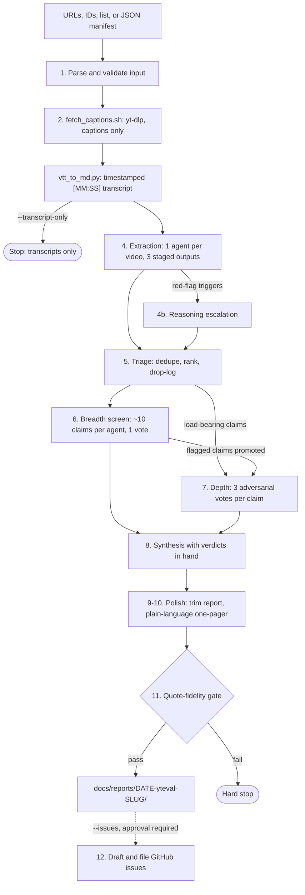

# yt-eval

**Turn YouTube videos into fact-checked reports, where each claim carries a timestamped quote and a cited source.**

[](LICENSE)
[](https://claude.com/claude-code)
[](https://openai.com)
[](https://antigravity.google)
[](install.sh)
[](skills/yteval/scripts)

YouTube is full of confident claims: "this model is 10x faster", "this API costs $X",
"this flag was removed". An LLM summary of the video repeats those claims, and sometimes
invents new ones. **yt-eval does not summarize.** It pulls out every statement a viewer
could check and find wrong, then checks each one against primary sources. The report says
plainly where the video is **wrong**, where it is **out of date**, and where it states a
number it never showed.

It ships as one agent skill, `yteval`, for **Claude Code**, **OpenAI Codex**, and
**Google Antigravity / Gemini**. One installer covers all three.

```bash
/yteval https://www.youtube.com/watch?v=VIDEO_ID
```

Before the expensive verification starts, the run prints its triage, so you can see what
will and will not be checked. The rows below are the illustrative example from
[`references/output-format.md`](skills/yteval/references/output-format.md):

```text
TRIAGE — 47 claims extracted across 4 videos
  → 9 deduped (asserted by more than one video, verified once)
  → 14 promoted to depth tier
  → 24 to breadth tier only
  → projected fan-out: 3 breadth + 42 depth = 45 agents

NOT ADVERSARIALLY VERIFIED (24)
  [not load-bearing · 19] — screened by the breadth tier, verdict: Screened
  [not checkable · 4]     — excluded from BOTH tiers, never checked at all
  [depth ceiling reached · 1] — screened only; budget artifact, worth overriding
    Fag2QTB2Vd8 [19:55]  "most retail traders lose money"
      ranked 16th of 15 — closest miss
```

The run finishes only after a mechanical gate has matched every quoted line in the
report against the transcript:

```text
quote fidelity OK — <N> verified, <M> unchecked (no timestamp), across <K> transcripts
```

> **Cost warning.** A full run uses a real multi-agent budget. It starts dozens of
> verification subagents with web search, and you cannot undo that spend once it starts.
> `--transcript-only` fetches captions and starts no agents at all.

## Highlights

- **Checks claims, does not summarize.** Each claim gets a verdict: `Verified`, `False`,
  `Stale`, `Misleading`, `Screened`, or `Open`. Each verdict names the tier that produced it.
- **`Stale` is separate from `False`.** The video's `upload_date` decides whether a claim
  was wrong when published or has gone out of date since. A `Stale` verdict must say when
  the fact changed (`changed_on`).
- **Adversarial depth tier.** Three independent agents per claim are told to *refute* it.
  Two refutations out of three sink the claim. When unsure, the verdict is `Open`, never `Verified`.
- **No verdict from memory.** No verifier may return `false`, `stale`, or any depth
  verdict without a URL it actually fetched.
- **Quote-fidelity gate.** Every `[MM:SS] "quote"` in the report is checked against the
  transcript of the video it is attributed to. A failure stops the run.
- **Reports on its own blind spots.** The report lists dropped claims, failed videos, and
  unchecked quotes. It does not hide them.
- **Captions only.** No audio download, no speech-to-text, no `pip install`.

## How it works



| Stage | What happens | Verification design |
|---|---|---|
| **1. Parse** | Accepts URLs, 11-char IDs, lists, JSON arrays, or manifests. Anything not on `youtube.com`/`youtu.be` is rejected. | An unknown manifest key is an error, so a typo like `depth_celing` cannot quietly fall back to the default. |
| **2. Fetch** | [`fetch_captions.sh`](skills/yteval/scripts/fetch_captions.sh) runs yt-dlp with `--skip-download --no-playlist`, a concurrency cap, 2 s launch spacing, and a 180 s timeout. | Reads yt-dlp's log to tell `no-captions`, `unavailable`, `rate-limited`, `timeout`, and `error` apart. A `rate-limited` failure drops concurrency to 1 for the rest of the batch. |
| **2. Convert** | [`vtt_to_md.py`](skills/yteval/scripts/vtt_to_md.py) turns WebVTT into `[MM:SS] text` lines with a metadata header. | Keeps the overlap between rolling captions on purpose, so each phrase stays pinned to its real timestamp. |
| **4. Extract** | One agent per video reads the transcript once and writes three outputs in order: eight-bucket extraction, eligibility, and reasoning analysis. | Each claim carries a verbatim quote and a timestamp. `evidence` is strict: `demonstrated` means the result was shown on screen. |
| **4b. Escalate** | A dedicated reasoning agent runs only when a trigger fires: ≥5 red flags, a demonstrated:asserted ratio below 0.2, or ≥2 sales-pitch markers. | It reads targeted regions only, never the full transcript again. Clean tutorials never pay for it. |
| **5. Triage** | Merges duplicate claims across videos, ranks them by how much the conclusions depend on them, and prints the drop-log and projected agent count. | Runs on the session model, because nothing downstream can check a claim that triage dropped. |
| **6. Breadth** | Every checkable claim is screened once, about 10 per agent. | A screen, not a verdict: it returns `screened` or `flagged`, never `Verified`. |
| **7. Depth** | Load-bearing claims plus anything breadth flagged, up to `--depth-ceiling`. | Three adversarial votes per claim, with `upload_date` taken from run state rather than the extraction agent's copy. |
| **8–10. Synthesize and polish** | Writes `report.md` (technical) and `onepager.md` (plain language). | Synthesis never sees transcripts, only extraction output and verdicts. `.bak` copies are made before any in-place trimming. |
| **11. Gate** | [`check_quotes.py`](skills/yteval/scripts/check_quotes.py) checks every quote in both documents. | Fails on a fabricated quote, a misattributed quote, or when unchecked quotes outnumber verified ones. |
| **12. Issues** | Optional. Drafts issues from findings for a repo you name. | Dedupes against open *and* closed issues, then waits for explicit approval of the whole batch. |

## Engineering highlights

**Prompts are versioned files, not prose.** The extraction, triage, breadth, and depth
prompts live in [`skills/yteval/prompts/`](skills/yteval/prompts) and are copied into each
run unchanged. This rule comes from a measured failure. A breadth prompt written fresh in
one session included one line that let the verifier skip web search. That run had a **66%
false-positive rate**: 19 of 29 `false`/`stale` flags collapsed once a sourced re-check
was required.

**The pipeline audits itself.** Every claim promoted from breadth to depth gets three
adversarial votes. The rate at which depth overturns breadth flags is therefore a free
measure of how well the screen worked. The run prints that rate before synthesis. Above 60%,
the run treats the screen as broken and re-screens the affected flags instead of
publishing them with a caveat.

**The quote gate checks against the transcript itself.** Transcripts are gitignored, so
the quotes in the report are the only evidence a reader ever sees. The gate normalizes
case, whitespace, and typographic punctuation, but the words must match exactly. It searches
a window of ±3 cues around the cited timestamp, joined into one stream because rolling
captions split phrases across cues. A quote with the right words at the wrong time is
reported as `wrong timestamp`, not as a fabrication. Each quote on a line is matched to the
attribution that follows it. [`test_check_quotes.py`](skills/yteval/scripts/test_check_quotes.py)
runs 7 regression checks, including two false-pass bugs the gate has shipped before. It
needs no test framework.

**Cost is bounded and shown before it is spent.**
- `--depth-ceiling` caps the adversarial tier.
- Breadth batches about 10 claims per agent.
- The projected fan-out, `ceil(claims/10) + 3 × depth_ceiling`, is printed before any
  verifier starts.
- Verdicts are checkpointed to `.verdicts.json` before synthesis, because verification is
  roughly 89% of the spend.
- Subagents are started in batches of 3–4, not 20.

**The input layer was fixed against real failures.**
- YouTube IDs can start with `-`. File paths use a `./` prefix, yt-dlp gets `--` before its
  arguments, and the ID regex uses lookarounds instead of `\b`.
- IDs are reduced to `[A-Za-z0-9_-]` before they are used as filenames.
- Bare `playlist?list=` URLs are refused. Expanding a playlist needs explicit
  confirmation of the video count.
- An HTTP 429 is reported as `rate-limited`. Earlier it was reported as `no-captions`,
  which wrongly told the reader those videos had no captions.

**Transcripts are untrusted input.** Captions come from whoever uploaded the video. Text
in them aimed at an automated reader is recorded as a red flag and never followed. Issue
filing has further guards:
- The repo name must match `^[A-Za-z0-9_-]+/[A-Za-z0-9_-]+$`.
- The target repo's agent guidelines are read as raw text over HTTP, never by cloning the repo.
- Approval covers one run and never carries over to the next.

**The installer only copies files.** [`install.sh`](install.sh) runs under
`set -euo pipefail`.
- It never edits config files or installs packages.
- It respects `CLAUDE_CONFIG_DIR`.
- It skips duplicate destinations that resolve to the same file (`-ef`).
- It never deletes a destination that points back at the source tree. For example,
  `--project --uninstall` run from this repo leaves `.agents/skills/yteval` alone.
- It reports missing dependencies and exits non-zero, but does not install them.

## Requirements

| Tool | Required | Notes |
|---|---|---|
| An agent runtime | yes | Claude Code, OpenAI Codex, or Google Antigravity / Gemini |
| `yt-dlp` | yes | `pipx install yt-dlp`. Called as a binary, never imported. |
| `python3` | yes | Standard library only. Nothing to `pip install`. |
| `bash`, `timeout` | yes | Used by the installer and the caption fetcher |
| `gh` | no | Only for `--issues`, and it must be authenticated |
| `deno` | no | If missing, yt-dlp prints a harmless "No supported JavaScript runtime" warning |

## Install

```bash
git clone https://github.com/z0rd0n88/yt-eval.git && cd yt-eval && ./install.sh
```

| Command | Effect |
|---|---|
| `./install.sh` | Install for all three platforms in your home directory (same as `--all`) |
| `./install.sh --claude` | Claude Code only |
| `./install.sh --codex` | OpenAI Codex only |
| `./install.sh --gemini` (alias `--antigravity`) | Google Antigravity / Gemini only |
| `./install.sh --project` | Install into the current directory's `.claude/` and `.agents/` |
| `./install.sh --uninstall` | Remove installed copies. Combine with the flags above to choose which ones. |
| `./install.sh --help` | Print usage |

Platform flags can be combined, for example `./install.sh --claude --codex`. After
installing, the script checks for `yt-dlp`, `python3`, and an authenticated `gh`. If a
required tool is missing, it says so and exits with status 1.

## Usage

Start your agent in the directory where you want reports written, then run:

```bash
/yteval --transcript-only https://www.youtube.com/watch?v=VIDEO_ID   # captions only, no agents
/yteval https://www.youtube.com/watch?v=VIDEO_ID                     # full verified report
/yteval --depth-ceiling 3 URL_ONE URL_TWO URL_THREE                  # compare videos, small depth budget
/yteval --help                                                       # print all options
```

| Option | Values | Default | Effect |
|---|---|---|---|
| `<input>` | URL, 11-char ID, list, JSON array, manifest, or a file path to any of these | — | The videos to process |
| `--transcript-only` | flag | off | Stop after converting captions. No agents and no report directory. |
| `--cap` | 1–8 | `4` | Maximum concurrent fetches and extraction agents |
| `--depth-ceiling` | int ≥ 0 | `15` | Claims sent to adversarial verification. `0` turns off that tier. |
| `--skip` | `evaluate` \| `polish` | — | Skip a stage group. Can be repeated. |
| `--issues [repo]` | flag + optional repo | off | File findings as issues in a repo you name, after your approval |
| `--out` | path | — | Override the output directory |
| `--playlist` | flag | off | Allow playlist expansion, after you confirm the video count |

The run stops to ask you only twice: to confirm a playlist's video count, and to approve
issue filing. Every other stage runs to completion without asking.

## Output

```text
docs/reports/<YYYY-MM-DD>-yteval-<slug>/
├── README.md       # one-line verdict, file index, source table, run provenance
├── report.md       # technical report: method, per-video verdicts, verdict table, drop-log, sources
├── onepager.md     # the same facts in plain language
└── transcripts/    # gitignored
    ├── <ID>.en.vtt
    └── <ID>.md
```

The source table lists every input video, including failed ones, with a status of
`covered`, `downgraded (reason)`, or `failed (reason)`. Transcripts are timestamped
markdown. This is real output of `vtt_to_md.py` on a three-cue sample:

```text
[00:01] All right, guys. In this video, we're going to be building a stock trading
[00:02] going to be building a stock trading
[00:03] going to be building a stock trading agent inside of Claude Code and by
```

## Platform support

| | Claude Code | OpenAI Codex | Google Antigravity / Gemini |
|---|---|---|---|
| Installer flag | `--claude` | `--codex` | `--gemini` / `--antigravity` |
| User install | `${CLAUDE_CONFIG_DIR:-~/.claude}/skills/yteval/` | `~/.agents/skills/yteval/` | `~/.gemini/config/skills/yteval/`, plus `~/.gemini/antigravity-cli/skills/yteval/` if that directory exists |
| Project install | `.claude/skills/yteval/` | `.agents/skills/yteval/` | `.agents/skills/yteval/` |
| Invoke | `/yteval` | Activate the `yteval` skill | `/yteval`, or paste a YouTube URL |
| Breadth / depth model | `sonnet` / `sonnet` | default worker tier | `flash` / `pro` via `invoke_subagent` |
| Discovery inside this repo | — | `.agents/skills/yteval` symlink | `.agents/skills.json` |

## Repository layout

```text
.
├── install.sh                  # cross-platform installer and uninstaller
├── skills/yteval/
│   ├── SKILL.md                # skill entry point: the 12-stage pipeline and guardrails
│   ├── prompts/                # extraction, triage, breadth, depth (copied unchanged into each run)
│   ├── references/             # JSON schemas, per-role prompt requirements, output contract
│   └── scripts/
│       ├── fetch_captions.sh   # parallel yt-dlp fetch with failure classification
│       ├── vtt_to_md.py        # WebVTT to timestamped markdown
│       ├── check_quotes.py     # quote-fidelity gate
│       └── test_check_quotes.py
├── .agents/                    # skills.json manifest and skill symlink for Codex and Gemini
├── AGENTS.md / GEMINI.md       # rules for agents working on this repo
└── baton-pass/                 # handoff notes between sessions
```

Run the quote-gate tests with `python3 skills/yteval/scripts/test_check_quotes.py`.

## Limitations

- **No captions means no coverage.** There is no speech-to-text fallback. The run reports
  `no-captions` for that video and continues.
- **Dating a claim needs a source from the time.** If archive lookups fail, the verdict is
  `Open` ("could not confirm either way"), not a guess.
- **Results depend on the model and on which sources it can reach.** yt-eval finds claims
  worth doubting and does real work on them. It is not an oracle.

## Uninstall

```bash
./install.sh --uninstall            # remove from all platforms
./install.sh --uninstall --claude   # remove from one platform
./install.sh --uninstall --project  # remove the project-scoped copies
```

## License and author

Released into the public domain under [The Unlicense](LICENSE).

Built by [@z0rd0n88](https://github.com/z0rd0n88).
